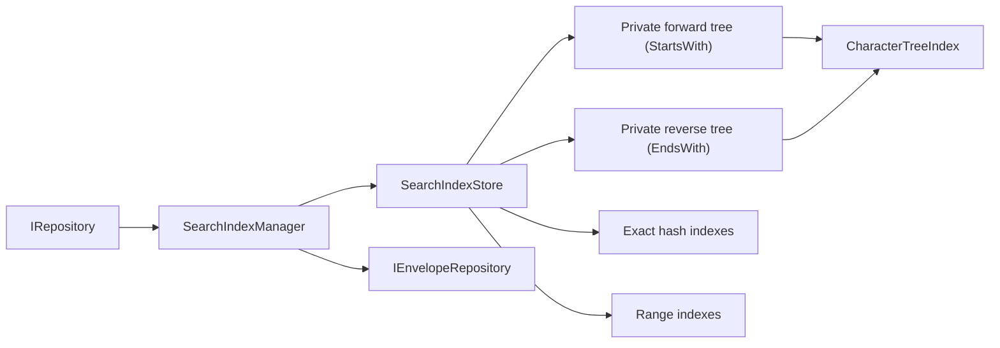

# InterfaceDB Character Tree Index Validation and Adoption Roadmap

Date: 2026-07-29

## Performance Hardening Update

Updated: 2026-07-30

The original source documented below was frozen by SHA-256 and measured before
any production optimization. A persistent BenchmarkDotNet harness and expanded
correctness/stress suite were then added to the character-tree solution.

The accepted phase-two implementation now passes 64 tests and a Release build
with zero warnings or errors. On the same benchmark job and machine:

| Operation | Original | Optimized | Change |
|---|---:|---:|---:|
| Build and compact 50,000 | 397.33 ms / 184.75 MB | 139.09 ms / 74.10 MB | 65.0% faster, 59.9% less allocation |
| Exact hit, rotating keys | 1.345 us / 1,488 B | 477.29 ns / 64 B | 64.5% faster, 95.7% less allocation |
| Prefix returning 50, rotating prefixes | 47.25 us / 117,488 B | 6.127 us / 1,280 B | 87.0% faster, 98.9% less allocation |
| Prefix returning 5,000 | 4.872 ms / 11.66 MB | 1.007 ms / 102,216 B | 79.3% faster, 99.1% less allocation |
| Empty prefix returning 50,000 | 55.613 ms / 116.29 MB | 12.957 ms / 1.02 MB | 76.7% faster, 99.1% less allocation |
| High-fan-in tombstone query | 145.6 ms | 644.7 us | 99.6% faster |
| High-fan-in removal and compact | 454.5 ms | 6.079 ms | 98.7% faster |
| Retained memory, 50,000 | 161,229,560 B | 45,193,928 B | 72.0% lower |

The optimized high-fan-in paths allocate temporary hash-based multisets:
558.26 KB for the collision query and 2.98 MB for removal/compaction, compared
with 118.23 KB and 2.00 MB originally. This bounded allocation is the explicit
tradeoff for removing quadratic latency.

The tree now exposes allocation-free `CountExact` and `CountByPrefix`, uses
lazy/adaptive nodes, pre-sizes snapshots, skips empty overlays, and applies
tombstones in batches. Full measurements, source hashes, commands, and
remaining tree work are in:

```text
C:\Code\C#\OldGithub\github\AgileCoding.Library.Indexers\
  PERFORMANCE-BASELINE.md
C:\Code\C#\OldGithub\github\AgileCoding.Library.Indexers\
  PERFORMANCE-ROADMAP.md
```

This update supersedes the original performance blockers and Phase 1 status
later in this document. It does not authorize InterfaceDB integration yet.
InterfaceDB store consistency, maintenance-failure handling, lifecycle, and
end-to-end tests remain outstanding. Forward and reverse tree direction also
remains to be implemented for manager-owned `StartsWith` and `EndsWith`
patterns.

## Executive Decision

Do not integrate the character tree into InterfaceDB until the remaining
manager and store correctness work is complete.

The index is functionally credible and has two strong advantages over
InterfaceDB's current combined string index:

- about 49% lower retained managed memory on the measured 50,000-entry
  workload;
- stable retained memory after full value replacement, while InterfaceDB's
  current prefix tree retained almost another complete tree.

The original build also passed its then-current 53 tests, a randomized
differential test, and a concurrent reader/writer stress test.

The measured character-tree performance blockers from the original assessment
have now been addressed. The current decision is **complete manager/store
correctness, add directional search, run end-to-end benchmarks, then adopt
conditionally**.

## Scope and Exact Source

The validated source is:

```text
C:\Code\C#\OldGithub\github\AgileCoding.Library.Indexers\
  AgileCoding.Library.Indexers.CharacterTreeIndex
```

Key source identity:

| Item | Value |
|---|---|
| Target framework | `net10.0` |
| Package ID | `AgileCoding.Library.Indexers.CharacterTreeIndex` |
| Effective default version | `1.0.0` |
| `CharacterTreeIndex.cs` modified UTC | 2026-06-27 04:20:58 |
| `CharacterTreeIndex.cs` SHA-256 | `5BEDD7FC13EB351E0A17FDD6DB91F5D0D0152DADB179292B6B1A99979A54200B` |
| `CharacterTreeIndexNode.cs` SHA-256 | `FA0E19662C90060FD11937ABBDBBBBD9C22FD8D983AC94704B17DD4D12C70BB4` |

The project directory is untracked inside the parent
`C:\Code\C#\OldGithub\github` repository. The parent Git commit is from 2021
and does not identify this index source. A production dependency therefore
needs a canonical source repository and immutable package version before
InterfaceDB can consume it.

This document supersedes the character-tree portion of
[the broader current-state audit](../documentation/current-state-audit-2026-07-29.md),
which inspected a different candidate path and did not yet contain comparative
benchmarks.

## InterfaceDB State Relevant to This Work

InterfaceDB is a working .NET 10 file-backed object database prototype. The
current tree builds with zero warnings and errors, the analyzer tests pass, and
the executable integration harness reports 49 passing scenarios. Exact, range,
prefix, `AND`, `OR`, nested-property, update, and delete index behavior all
have basic integration coverage.

The index path is not production-safe yet:

1. `SearchIndexStore<TContract>` mutates ordinary dictionaries, sorted
   dictionaries, and hash sets without synchronization.
2. A prior public-API stress probe persisted and scanned 4,000 records but an
   indexed query returned only one.
3. `FileEnvelopeRepositoryBase.PublishAsync` swallows subscriber exceptions
   and disposes the failed subscription. One index update failure can silently
   stop all later index maintenance.
4. The current prefix tree removes physical keys but never prunes empty nodes.
   The churn test in this assessment quantifies the resulting retained-memory
   growth.
5. `SearchIndexManager` has subscriptions and a future tree would own
   disposable locks, but the manager currently has no disposal path for these
   resources.
6. Prefix candidate-count estimates are part of `AND` planning. Any
   replacement must retain a count-only operation and must not materialize a
   prefix result merely to estimate its size.

Other confirmed release blockers remain outside this index project:

- multiple-cardinality suffix reuse after deleting a middle item;
- incomplete async stream reads in `BinaryObjectSerializer`;
- unsafe synchronous bridging over `ValueTask` in migration code;
- uncommitted, API-breaking cache-mode work;
- stale benchmark artifacts and no release CI/package provenance.

The full evidence and remaining product gaps are in the broader current-state
audit linked above.

## Current and Candidate Designs

### InterfaceDB Current String Index

For a normal string property, `SearchIndexDiscovery` selects
`SearchIndexMode.Exact | SearchIndexMode.Prefix`.

`SearchIndexStore.PropertySearchIndex` then maintains both:

- `Dictionary<object, HashSet<string>>` for exact lookup;
- a prefix tree where the root and every character node contain a
  `HashSet<string>` of every matching physical envelope key below that prefix.

The current design favors reads. Prefix lookup walks the prefix and copies one
precomputed key set. The cost is that each physical key is retained at every
prefix node, writes update every set, and removed character paths are never
pruned.

### Character Tree Candidate

`CharacterTreeIndex<string>` stores physical keys only at terminal nodes. It
maintains:

- a compacted main tree;
- a pending-add tree;
- a pending-remove tombstone tree;
- subtree value counts;
- a `ReaderWriterLockSlim`.

Prefix lookup walks to the prefix and traverses every descendant terminal.
This reduces retained key references and permits branch pruning, but moves work
from writes and memory to query time.

### Complexity Summary

Let:

- `L` be the indexed string length;
- `R` be the number of returned items;
- `N` be the descendant node count under a prefix;
- `C` be the number of items sharing one exact value;
- `T` be the number of matching tombstones.

| Operation | InterfaceDB current | Character tree current |
|---|---:|---:|
| Add | About `O(L)` hash operations and `L + 1` retained key memberships | About `O(L log B)` tree operations and one terminal item reference |
| Exact snapshot | About `O(1 + R)` | About `O(L + R)` without tombstone collisions |
| Prefix snapshot | About `O(L + R)` | About `O(L + N + R)` |
| Remove | About `O(L)`; empty nodes remain | About `O(L + C)` before compaction |
| Tombstone masking | Not applicable | Can degrade to `O(R * T)` |
| Compaction | Not applicable | Touched branches, but terminal removals can be quadratic |
| Retained memory | Key reference repeated at each prefix | Nodes plus terminal references plus pending tombstones |

`B` is the character branching factor. The candidate uses
`SortedDictionary<char, ...>` at every node.

## Validation Method

### Environment

| Item | Value |
|---|---|
| OS | Windows 10.0.19045 x64 |
| SDK/runtime | .NET SDK 10.0.301 |
| CPU | AMD Ryzen 9 3950X, 16 cores / 32 logical processors |
| RAM | 31.9 GiB |
| Build | Release, optimized |

### Comparison Harness

A disposable console harness referenced the exact character-tree project and
implemented a faithful isolated copy of InterfaceDB's current combined exact
and prefix structures. The comparison intentionally excluded file I/O,
serialization, expression compilation, and envelope hydration so the numbers
describe index structures only.

The main data set contained:

- 50,000 entries;
- 30-character indexed string values;
- 20-character physical storage keys;
- 1,000 shared value buckets and unique suffixes.

Query selectivities:

| Query | Results per operation |
|---|---:|
| Exact hit | 1 |
| Selective prefix | 50 |
| Broad prefix | 5,000 |
| Empty prefix | 50,000 |

Key timing tables use the median of three independent process runs. Allocation
figures are from one representative run. Retained memory used
`GC.GetTotalMemory` after forced compacting collections, with the input data
allocated before the measurement baseline.

This is a controlled directional comparison, not a publishable
BenchmarkDotNet result. Final adoption still requires BenchmarkDotNet and
end-to-end InterfaceDB measurements from a committed release candidate.

## Results

### Build and Retained Memory

| Measure | Character tree | InterfaceDB current | Result |
|---|---:|---:|---:|
| Median add/build phase, 50,000 | 437.9 ms | 739.6 ms | Tree 40.8% faster |
| Retained managed memory | 153.76 MiB | 300.14 MiB | Tree 48.8% lower |
| Retained bytes per entry | 3,224.6 B | 6,294.4 B | Tree 48.8% lower |

The tree then required about 3 ms for its initial compaction, leaving the
complete initial build about 40% faster. The relative result is strong, but
the absolute tree footprint is still high.
At 3.2 KB per 30-character entry, very large indexes would require substantial
memory. Eager per-node `SortedDictionary` and `List` objects are major
optimization targets.

### Snapshot Query Latency

| Operation | Character tree | InterfaceDB current | Tree/current |
|---|---:|---:|---:|
| Exact hit | 5.440 us | 1.910 us | 2.85x |
| Prefix, 50 results | 223.152 us | 6.225 us | 35.85x |
| Prefix, 5,000 results | 4.825 ms | 89.750 us | 53.76x |
| Prefix, 50,000 results | 57.414 ms | 391.570 us | 146.62x |

The current index wins because it copies a precomputed set. The character tree
must visit the matching subtree on every prefix query.

Some absolute times may be tolerable once InterfaceDB loads thousands of
envelopes, but the allocation volume and planner use make direct adoption
premature.

### Snapshot Allocations

| Operation | Character tree | InterfaceDB current | Tree/current |
|---|---:|---:|---:|
| Exact hit | 1,488 B | 176 B | 8.45x |
| Prefix, 50 results | 131,221 B | 1,897 B | 69.2x |
| Prefix, 5,000 results | 11,656,883 B | 168,496 B | 69.2x |
| Prefix, 50,000 results | 116,295,038 B | 1,508,740 B | 77.1x |

The broad-query allocation is not explained by the output list alone.
`AddSubtreeValues` calls LINQ `Reverse()` for every visited node, creating
iterators and buffers throughout traversal. `FindSnapshot` also starts with
zero-capacity lists even though subtree counts are available.

### Mutation Cost

Median isolated results for adding 5,000 new values:

| Index | Time |
|---|---:|
| Character tree pending adds | 2.06 ms |
| InterfaceDB current | 19.76 ms |

The pending-add tree is about 9.6 times faster for this batch. A full mixed
cycle of 5,000 adds, 5,000 removes, and required compaction was about 64.8 ms
for the character tree versus 49.3 ms for the current structure. Candidate
removal and compaction offset its add advantage.

### Full-Replacement Churn

A separate test built 25,000 entries, replaced every indexed value while
retaining each physical key, compacted the candidate, and forced collection.

| Measure | Character tree | InterfaceDB current |
|---|---:|---:|
| Retained after initial build | 77.58 MiB | 149.89 MiB |
| Retained after full replacement | 77.58 MiB | 296.01 MiB |
| Growth | 808 B | 146.11 MiB |
| Growth percentage | 0.001% | 97.5% |

This is the candidate's strongest result. Compaction releases old branches.
The current prefix tree leaves old nodes and their emptied hash-set capacity in
place, so changing unique string values can make retained memory grow with
historical values rather than current values.

### Same-Value Collision and Tombstones

A diagnostic workload placed 10,000 distinct physical keys at the same
indexed value (`"active"`), then removed 5,000 in reverse order.

| Measure | Character tree | InterfaceDB current |
|---|---:|---:|
| Remove 5,000 | 359.6 ms | 1.90 ms |
| Ten exact snapshots with 5,000 results | 1,664.8 ms | 1.16 ms |
| Candidate compaction | 213.5 ms | Not applicable |

This is a deliberately adverse workload, but it maps to common database
properties such as status, country, tenant, or category. Terminal values and
tombstones are lists. Removal, masking, and compaction repeatedly perform
linear scans, causing quadratic behavior when many physical keys share a
property value.

This issue is a hard adoption blocker.

### Correctness and Concurrency

Verified:

```text
CharacterTreeIndex MSTest:
53 passed, 0 failed, 0 skipped

Randomized differential test:
10,000 initial entries
25,000 add/remove/query/compact operations
13,861 final entries
All exact, prefix, and final full-scan sets matched

Concurrent stress:
8 writers, 40,000 total writes
8 readers, 80,000 total reads
40,000 final entries
0 exceptions
```

The candidate's own locking is effective for one index instance. It does not
solve InterfaceDB's multi-property consistency because `_valuesByPhysicalKey`,
exact indexes, range indexes, and runtime-type stores remain separate mutable
structures.

## Candidate Strengths

- Correct exact and prefix semantics under the tested ordinal,
  case-sensitive configuration.
- Snapshot APIs are safe after a lock is released.
- Thread-safe internal mutation and reads.
- Pending additions are cheap.
- Main/add/remove overlays make changes visible before compaction.
- Compaction grafts new subtrees and prunes fully removed branches.
- Retains physical keys only at terminal nodes instead of every prefix.
- Retained memory reflects current values after compaction rather than all
  historical character paths.
- The same tree can serve exact and prefix string queries, avoiding duplicate
  exact and prefix ownership.

## Original Candidate Blockers and Requested Performance Work

The following sections preserve the findings that defined the optimization
work. The 2026-07-30 update at the top of this roadmap records which items are
now complete and provides the accepted measurements.

### P0: Replace Linear Terminal Matching for InterfaceDB Use

`CharacterTreeIndexNode.Values` is a `List<TItem>`. `CanRemoveFromMain`,
`RemoveValue`, `RemoveValues`, and `TryRemoveFirstMatch` linearly scan values.

Required direction:

- add a unique-item mode backed by `HashSet<TItem>` or an equivalent keyed
  terminal collection;
- keep multiset semantics only when explicitly required;
- apply tombstones with a hash-based count/set rather than repeated list
  removal;
- make committed removal and compaction approximately `O(1)` per physical key
  after the character path is found.

InterfaceDB uses unique physical envelope keys, so unique-item semantics are
the correct default for its adapter.

### P0: Remove Per-Node Prefix Traversal Allocations

Current subtree traversal applies LINQ `Reverse()` at every node.

Required direction:

- use an allocation-free iterative traversal;
- do not preserve lexical output order for InterfaceDB, whose candidate set is
  unordered;
- pre-size result storage from subtree counts;
- provide a direct copy-to-destination API so InterfaceDB can fill its
  `HashSet<string>` without first creating a list and then copying it again.

### P0: Add Count-Only Query APIs

InterfaceDB calls `EstimateCount` before choosing the best side of an `AND`.
The original candidate tracked subtree counts but did not expose them.

Required APIs:

```csharp
int CountExact(string? key);
int CountByPrefix(string? prefix);
```

Counts must apply main minus remove plus add semantics without materializing
items. Case-insensitive mode must count all matching branches correctly.

### P1: Add Fast Paths for the Common Case

With `IgnoreCase == false` and no pending removals:

- exact lookup should walk one path directly;
- prefix lookup should avoid searching all three overlays when an overlay is
  empty;
- a compacted exact lookup should copy one terminal collection directly.

The current implementation creates iterator/stack machinery and examines
main, add, and remove trees even for a compacted case-sensitive exact hit.

### P1: Reduce Node Memory

Every node eagerly constructs a `SortedDictionary` and `List`, including leaf
nodes.

Evaluate:

- lazy child and value collections;
- `Dictionary<char, ...>` when deterministic traversal is not requested;
- a compact single-child representation before promoting to a dictionary;
- path compression/radix nodes for long unique suffixes.

Performance changes must be measured against realistic shared-prefix and
mostly-unique data, not only short names.

### P1: Make Compaction Iterative

`ApplyRemoveTree` and `MergeAddTree` recurse through shared character paths.
Ordinary names are safe, but unbounded indexed strings can create deep call
stacks. Use explicit frames or impose and document a maximum indexed key
length.

### P1: Reconsider Case-Insensitive Storage

`IgnoreCase` branches through upper, lower, and original characters at query
time. InterfaceDB currently recognizes ordinal prefix searches and should use
`IgnoreCase = false`.

If case-insensitive indexing is later required, normalize keys once at
ingestion with a specified comparison policy rather than branching at every
query character.

### P2: Expose Overlay and Compaction Metrics

InterfaceDB needs a bounded compaction policy. Expose:

- pending add count;
- pending remove count;
- main count;
- optional node count;
- last compaction duration/result.

This permits compaction after rebuilds, bulk writes, or a configured
pending-change threshold instead of compacting every write or allowing
tombstones to grow indefinitely.

## Correct InterfaceDB Layer

The character tree belongs inside the existing application index
implementation. It does not require another public or formal property-index
layer:



Responsibilities remain:

| Layer | Responsibility |
|---|---|
| `SearchIndexManager<T>` | Lifecycle, rebuild, stored/deleted events, query orchestration, enabled-pattern policy, runtime implementation stores, envelope materialization |
| `SearchIndexStore<T>` | Private expression evaluation and forward/reverse tree ownership, per-property consistency, old-value snapshots, count estimation, candidate physical-key sets |
| `CharacterTreeIndex<string>` | Character paths, terminal physical keys, overlays, internal structural synchronization |
| `IEnvelopeRepository<T>` | Persistence and physical envelope retrieval; no knowledge of the tree |

Do not put the character tree in:

- serialization;
- file naming or storage identity;
- envelope catalog storage;
- repository persistence;
- the public repository abstraction;
- the expression parser itself.

## Index Selection Policy

Adoption should be selective:

| Property/mode | Recommended structure |
|---|---|
| String `Exact + Prefix` | One hardened `CharacterTreeIndex<string>` |
| String `Prefix` only | Hardened `CharacterTreeIndex<string>` |
| String `Exact` only | Existing hash dictionary |
| String with explicit `Range` | Keep a dedicated range structure in parallel |
| Bool, enum, GUID exact | Existing hash dictionary |
| Numeric/date range | Dedicated range index, not character formatting |

The character tree should store physical envelope keys, not entities or
envelopes:

```csharp
CharacterTreeIndex<string> index;
index.Add(normalizedPropertyValue, physicalEnvelopeKey);
```

Using physical keys preserves the current query pipeline and avoids pinning
hydrated objects in index memory.

## InterfaceDB Work Required Before Integration

### 1. Establish a Store-Level Consistency Boundary

Add one reader/writer boundary around complete `SearchIndexStore` operations:

- `Clear`;
- `Upsert`, including removal of the old snapshot and addition of every new
  property value;
- `Remove`;
- count estimation and candidate snapshot creation.

Per-tree locking is insufficient. A query must not observe only part of a
multi-property update or race `_valuesByPhysicalKey`.

### 2. Make Internal Maintenance Failures Observable

Do not silently dispose the index-maintenance subscription.

Required behavior:

- log the exception and mark the index unhealthy;
- fail the write or schedule a deterministic rebuild;
- keep application callbacks isolated from mandatory internal maintenance;
- expose index health in diagnostics.

### 3. Add Manager-Owned Directional Search Trees

Keep the forward and reverse character trees as private implementation state
within the existing application index manager/store design. Do not add a new
formal property-index abstraction solely to wrap the tree.

Required behavior:

- construct a forward tree only when `StartsWith` is enabled;
- construct a reverse tree only when `EndsWith` is enabled;
- reverse character traversal inside the index without allocating reversed
  strings;
- update all enabled trees within one store-level consistency boundary;
- use count-only APIs during query planning;
- retain dictionary-backed exact indexes for exact-only patterns.

### 4. Preserve Query Semantics

Configure:

- ordinal physical-key equality;
- case-sensitive character paths;
- no item ordering comparer;
- unique physical keys at each indexed value.

The planner currently accepts both explicit `StringComparison.Ordinal` and the
one-argument `StartsWith`. The latter uses current-culture semantics in the
compiled predicate, while the index is ordinal. Restrict indexed prefix
optimization to explicit ordinal semantics or make the index and final
predicate semantics identical. An index may return extra candidates, but it
must never omit a true match.

### 5. Define Lifecycle and Disposal

After adding a disposable tree:

- make `PropertySearchIndex` and `SearchIndexStore` disposable;
- make `SearchIndexManager` dispose stored/deleted subscriptions and stores;
- compact once after initialization rebuild;
- compact after bounded bulk batches or threshold crossings;
- clear and dispose runtime-type stores when replaced.

Do not add an absolute project reference to the OldGithub path. Consume a
versioned package or a project placed in a canonical, controlled repository.

## Phased Roadmap

### Phase 0: Evidence Baseline

Status: **Complete**

- Identified exact source by path, timestamp, and hash.
- Original baseline release tests passed: 53/53.
- Differential behavior passed.
- Concurrent reader/writer stress passed.
- Measured build, retained memory, query latency, allocations, mutations,
  churn, and same-value collisions.
- Mapped the correct InterfaceDB ownership layer.

### Phase 1: Character Tree Performance Hardening

Status: **Core performance work complete**

Completed:

1. Added keyed multisets for high-fan-in values and tombstones.
2. Made tombstone masking and terminal compaction approximately linear.
3. Removed per-node LINQ traversal allocations.
4. Pre-sized snapshots from subtree counts.
5. Added count-only exact and prefix APIs.
6. Added compacted/case-sensitive fast paths.
7. Added persistent benchmarks and regression tests for high fan-in and broad
   prefixes.
8. Added lazy collections and adaptive single-child nodes.

Remaining tree work:

1. Add forward/reverse direction without reversed-string allocation.
2. Add direct copy-to-destination only if InterfaceDB end-to-end measurements
   show the extra API is worthwhile.
3. Make compaction iterative or impose a documented maximum key length.
4. Evaluate dictionary children, path compression, and unique-item mode only
   against measured workloads.

### Phase 2: InterfaceDB Index Correctness

Status: **Outstanding and independent of tree choice**

1. Lock complete `SearchIndexStore` reads and writes.
2. Add a 4,000+ concurrent save/search regression.
3. Stop swallowing mandatory index-maintenance failures.
4. Add index health and rebuild behavior.
5. Add manager/store/subscription disposal.
6. Fix or restrict non-ordinal one-argument prefix planning.

### Phase 3: Controlled Integration

Status: **Blocked by Phase 2 and directional-index work**

1. Publish a canonical prerelease package.
2. Add private manager/store-owned forward and reverse tree instances.
3. Create only the indexes required by enabled query patterns.
4. Retain hash exact indexes for equality-only properties.
5. Retain a dedicated range structure for range modes.
6. Rebuild and compact at manager initialization.
7. Add configurable compaction thresholds and diagnostics.

### Phase 4: Verification Gates

Status: **Outstanding**

Correctness gates:

- all existing InterfaceDB tests pass;
- candidate results equal a full predicate scan after add, update, delete,
  restart, watcher reconciliation, and migration;
- concurrent saves never lose index entries;
- high-fan-in values remain correct before and after compaction;
- cancellation and disposal do not deadlock or leak subscriptions.

Performance gates:

- retained memory remains at or below 60% of the current combined string index
  on the measured unique-value workload;
- a full replacement does not retain the previous character tree;
- exact lookup regression is reduced to an agreed budget;
- broad-prefix allocations are proportional to the returned collection, not
  descendant node count;
- high-fan-in remove, query, and compaction scale approximately linearly;
- end-to-end indexed queries are measured with strong, weak, metadata-only,
  and cold envelope hydration modes.

Required benchmark profiles:

- 10,000, 100,000, and 1,000,000 entries where memory permits;
- short names, long unique identifiers, phone prefixes, and low-cardinality
  status/country values;
- 0%, 1%, 10%, and 50% pending tombstones;
- exact miss/hit, narrow prefix, broad prefix, and empty prefix;
- single-threaded and concurrent read/write loads;
- rebuild, bulk save, update churn, delete churn, and compaction.

### Phase 5: Rollout

Status: **Not started**

1. Ship behind an internal configuration or feature flag.
2. Keep the existing implementation available for comparison during one
   prerelease cycle.
3. Record index type, entry count, node count, pending changes, memory
   estimate, rebuild duration, and compaction duration.
4. Rebuild automatically on health failure rather than continuing with silent
   false negatives.
5. Remove the old prefix implementation only after production-like workloads
   meet correctness and performance gates.

## Recommended Next Action

Implement forward/reverse direction in the character-tree project, then
address InterfaceDB's store-level consistency and maintenance-failure
behavior. Wire enabled patterns directly into the existing manager/store
implementation, retain dictionary-backed exact-only indexes, and run the
end-to-end InterfaceDB benchmark and correctness gates before replacing the
current prefix structure.

## Change Record

This assessment:

- originally added this roadmap only;
- now records the completed baseline-first character-tree performance pass;
- changed `CharacterTreeIndex<TItem>` only after freezing the original source
  hashes and benchmark artifacts;
- did not modify InterfaceDB production or test code;
- added a persistent BenchmarkDotNet and retained-memory harness;
- left all pre-existing working-tree changes untouched.
